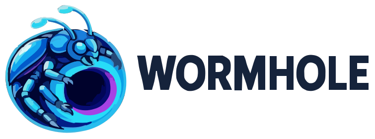
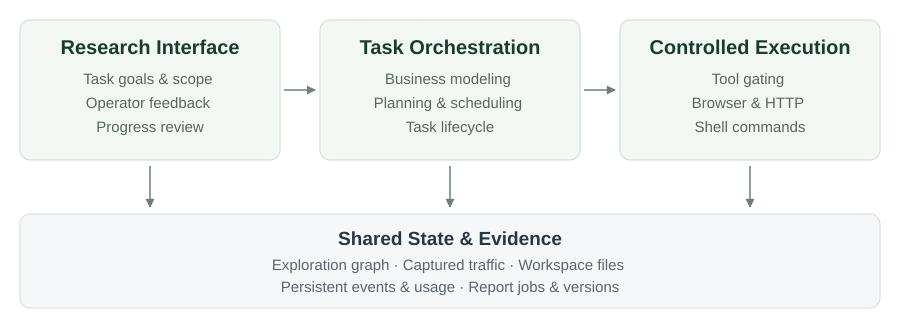

<p align="center">
  <picture>
    <source media="(prefers-color-scheme: dark)" srcset="web/public/brand/logo-light.svg" />
    
  </picture>
</p>

<h1 align="center">WORMHOLE</h1>

<p align="center"><strong>Secure reasoning and verification system for complex business systems</strong></p>
<p align="center">Turn research goals into evidence-driven investigations and reviewable results. </p>

<p align="center">
  <a href="LICENSE"></a>
  <a href="#quick-start"></a>
  <a href="docs/user-guide/quickstart.md"></a>
</p>

<p align="center">
  <a href="#project-overview">Overview</a> ·
  <a href="#how-to-advance-a-mission">Mission process</a> ·
  <a href="#system-architecture">Architecture</a> ·
  <a href="#quick-start">QuickStart</a> ·
  <a href="#document-navigation">Documentation</a> ·
  <a href="CONTRIBUTING.md">Contribute</a>
</p>

---

## Project Overview

A security test usually starts with an incomplete question: what data can be accessed by a certain type of identity, what pre-state does a business operation rely on, and whether existing anomalies are sufficient to constitute a vulnerability. As the test unfolds, new interfaces, permission relationships, and execution results will change the initial judgment.

WORMHOLE organizes security research around this process. It receives the goals and constraints given by the user, transforms the problem into an executable verification direction, coordinates business modeling and tool execution, and then sends the obtained facts back to the planning process. The task can thus unfold step by step along with the evidence, and researchers can add conditions, check the basis for judgments, or pause execution along the way.

The platform supports Web/API security testing, business logic analysis, source code auditing and vulnerability retesting. Its design focuses on how the task continues to advance: how the problem to be verified is formed, how execution resources are allocated, how the results affect subsequent decisions, and what the system bases on ending a study.

## How to advance a mission

Taking "checking the order access boundaries between two test accounts within the scope of authorization" as an example, WORMHOLE needs to gradually establish the connection between issues, operations and evidence.

### 1. Establish task boundaries from research questions

Upon receiving a task, WORMHOLE incorporates goals, system entry, identity conditions, and execution constraints into the task context and organizes the goals that require verification. For example, whether the order belongs to the current account, whether different identities can access the same object, and whether key status changes affect the access results can form different research directions.

These directions are stored in the exploration map along with the mission goals, so that subsequent actions, facts, and findings have clear attribution. The conditions added by researchers can also enter the task process and become the basis for continued planning.

### 2. Verify while understanding the system

WORMHOLE establishes or updates business models in the background, organizing portals, interfaces, identities and business processes. Checks that already have sufficient context can be executed first, and testing does not have to wait for the entire system modeling to be completed; after the modeling is delivered, new business information can be used for subsequent planning.

In the order scenario, if the access interface and test identity are known, the system can organize boundary checks first; the subsequently obtained status relationship or associated interface provides context for the new verification direction. Modeling and testing are advanced separately and connected in the task status.

### 3. Assign verification direction to available execution resources

When executable intentions appear in the exploration graph, WORMHOLE organizes the collection according to priority and is subject to task quota and execution concurrency constraints. Multiple execution units can handle different directions respectively, and the same intention determines the current execution ownership through the database claiming mechanism.

Each execution is bound to a specific task, intent and working directory, and the required tools are assembled according to the authorization. Browser operations, HTTP requests, command execution, and external capability calls are checked according to the corresponding policies, and the results are written into task records. Scheduling thus handles two issues simultaneously: what should be verified currently, and which operations are allowed to be performed under current conditions.

### 4. Let the execution result change the next step

After an inspection, WORMHOLE brings the execution results back to the planning process. New facts, existing discoveries, still-implemented intentions, and business models together form the context for the next round of decision-making, based on which the system organizes continued verification, waiting for other results or supplementary conditions.

For example, if the data of another account is observed, the object ownership, identity difference and actual impact should be further checked; if an access is denied, the result will be left for the current path. Whether to switch to other interfaces in the future still needs to be judged based on the task goal. Anomalies, negative results, and blocking conditions are part of the research process and can help explain why it was continued, diverted, or paused.

This feedback is persisted in the exploration graph and execution log. When the planning call is truncated or fails to produce effective action, the host saves the recovery state and tries again according to the policy; the user can also add identity, scope or business information to obtain new advancement conditions for the task.

### 5. Complete delivery according to evidence and execution boundaries

WORMHOLE treats the end of a task as a state transition that needs to be relied upon. Goal completion, coverage review, time budget, execution conditions and user operations affect the continuation, suspension and ending of tasks respectively. In the continuous mining mode, existing discoveries will not trigger the end alone; early closing requires submitting the coverage and referenced facts or findings, and the host will check the current status.

Registered findings are entered into an independent report queue, and the recurrence process, actual impact and non-covered scope are sorted out based on existing evidence, and the text version and manual modifications are retained. After the task is over, researchers can look back to see which questions were asked, what was actually performed, which conclusions were supported, and which directions remained conditional.

## System architecture

<p align="center">
  
</p>

The above process is coordinated by the task host. The interactive portal receives research questions and process intervention, orchestrates service maintenance task life cycle, business modeling and verification scheduling, and executes services to complete tool invocation under policy constraints. Exploration diagrams, raw flows, working files, and persistent events preserve a common research state, allowing different phases to be connected around existing facts.

Task scheduling, modeling and report sorting manage access and life cycle respectively: background modeling does not occupy ordinary task slots, the report queue reads existing evidence, and the results can still be sorted independently after the test is stopped. For the implementation entrance, see [Task Orchestration](pihost/src/domains/tasks), [Business Modeling](pihost/src/domains/modeling), [Tool Gating](pihost/src/domains/tools), [Exploration Map](pihost/src/domains/exploration), [Discovery and Reporting](pihost/src/domains/findings) and [Run Observability](pihost/src/domains/observability).

## Quick start

### Environment preparation

- Linux x86_64, Docker Engine and Docker Compose v2.
- Access npm, Debian, Go modules and browser download sources when building.
- Configure available model interfaces at runtime and ensure that the container has access to authorized test targets.

### Deployment

```sh
git clone https://github.com/Gach0ng/Wormhole.git WORMHOLE
cd WORMHOLE
cp .env.example .env
```

Edit`.env`, fill in the independent database password, then build and start:

```dotenv
POSTGRES_PASSWORD=replace-with-a-unique-strong-password
WORMHOLE_BIND=127.0.0.1
WORMHOLE_PORT=18887
```

```sh
docker compose up -d --build
docker compose ps
```

Open [http://127.0.0.1:18887](http://127.0.0.1:18887), create an administrator account, configure the model interface on the **LLM** page and activate it.

By default, only the local address is bound. Configure access portal, TLS and access control when using remotely; the database does not need to publish the host port. For startup problems, please check`docker compose logs -f wormhole`, or refer to [Troubleshooting](docs/user-guide/troubleshooting.md).

### Create the first task

1. Fill in the target system entrance, test target, identity conditions, allowed scope and restrictions.
2. Check the Agent configuration, tool permissions and execution policy to confirm that the model and target are reachable.
3. Start the task and observe the progress in the overview, execution path, task dialogue and business modeling.
4. Check and discover the corresponding original evidence, reports and uncovered areas, and supplement evidence or retest as needed.

See [Quick Start](docs/user-guide/quickstart.md) and [Task Management](docs/user-guide/tasks.md) for complete operating instructions. The same set of offline documentation is available through the in-app help portal.

## Extension and integration

The extension mechanism handles methods, tools, services and knowledge data respectively. Maintain reusable test methods through [Skill](docs/user-guide/skills.md), and access external tools through [MCP](docs/user-guide/mcp.md); installation, availability check, and Agent authorization are managed separately.

Asset and analysis services can be accessed on demand. [ScopeSentry](docs/extensions.md#scopesentry) provides company and asset synchronization entrance, [White-box analysis interface](docs/extensions.md#White-box service) supports code indexing and auditing of compatible services; [Analysis image](docs/extensions.md#rea-with local components) optionally installs REA, Ghidra, JADX and protocol tools. [Network Channel](docs/user-guide/network.md) Access the transit network via connectors and multi-hop routing, with additional permissions for Linux springboard commands and browsers explicitly configured by`compose.network.yaml`.

[PoC](docs/user-guide/pocs.md) and [Fingerprint](docs/user-guide/fingerprints.md) adopt independent data import mechanisms and retain source information. External services, heavy analysis components and complete knowledge data are not enabled by default with the basic platform. For deployment and configuration, see [Extensions] (docs/extensions.md).

## Development and Verification

The front-end uses TypeScript, React and Next.js; the server uses TypeScript, structured business data is stored in PostgreSQL, and traffic and file resources are managed by the corresponding storage module. The network connector and fingerprint adaptation engine use independent Go modules.

The source code is divided by responsibility into [front-end workspace] (web), [API and domain services] (pihost/src), [database migrations] (pihost/migrations), [built-in methods] (pihost/builtin-skills), [optional extensions] (extensions) and [behavior and integration tests] (pihost/tests). The deployment entry is the Compose file in the root directory, and the operation and maintenance script is located at [`scripts/`](scripts).

Local development requires Node.js ≥ 22.19.0 and separate PostgreSQL, configuration files, and data directories. For the configuration structure, see [Backend Development Instructions](pihost/README.md).

```sh
# Backend
cd pihost
npm ci
npm run typecheck
WORMHOLE_CONFIG=/absolute/path/config.dev.json npm run dev
```

```sh
# Start the front end in another terminal and execute it from the warehouse root directory
cd web
npm ci
WORMHOLE_API_URL=http://127.0.0.1:18887 npm run dev
```

Isolated acceptance uses a separate database and temporary configuration:

```sh
docker compose -f compose.acceptance.yaml up --build --abort-on-container-exit --exit-code-from tests
docker compose -f compose.acceptance.yaml down
```

The test report is saved in`artifacts/acceptance/`. The real model and complete analysis tool chain need to be configured separately. For test steps and boundaries, see [Test Instructions](pihost/docs/reference-tests.md). The performed verification scope is saved by date in [First Version Acceptance](docs/validation.md) and [Recent Update Acceptance](docs/update-2026-11-16.md). The test results of the fixed environment should not be regarded as general effects or performance commitments.

## Operation and data

The database and running resources are stored in the`database`and`runtime`named volumes of Compose respectively. Perform a consistent backup before updating, then preserve the volume and rebuild the application:

```sh
sh scripts/backup.sh ./backups
git pull --ff-only
docker compose build wormhole
docker compose up -d wormhole
```

Database migration is performed when the service starts. Normally stop using`docker compose down`;`down -v`will delete the persistent volume. For the recovery process, see [Backup and Recovery](docs/backup.md). Preview and then execute task resource cleanup, retaining evidence, reports and shared references, see [Resource Cleanup](docs/task-resource-cleanup.md).

## Document Navigation

- **Usage and configuration:**[Quick Start](docs/user-guide/quickstart.md), [Task Management](docs/user-guide/tasks.md), [LLM Configuration](docs/user-guide/llm.md), [Agent Configuration](docs/user-guide/agents.md).
- **Modeling and Evidence:**[Business Modeling](docs/user-guide/modeling.md), [Traffic Management](docs/user-guide/traffic.md), [Discovery Management](docs/user-guide/findings.md), [Report Jobs](docs/report-jobs-and-overview.md).
- **Development and Deployment:**[Backend Description](pihost/README.md), [Optional Extensions](docs/extensions.md), [Workspace](docs/user-guide/workspace.md), [Backup and Recovery](docs/backup.md).
- **Verification and changes:**[Test instructions](pihost/docs/reference-tests.md), [First version acceptance](docs/validation.md), [Update record](docs/update-2026-11-16.md).

## Participate in contribution

Submissions of reproducible issues, feature proposals, code improvements, and documentation corrections are welcome. When reporting a problem, please provide the version, deployment method, reproduction steps, expected behavior, and desensitization logs; changes involving execution permissions, life cycle, or persistence should be accompanied by behavioral regression results.

Read the [Contribution Guide](CONTRIBUTING.md) before starting, report issues via [Issues](https://github.com/Gach0ng/Wormhole/issues), and submit changes via [Pull Requests](https://github.com/Gach0ng/Wormhole/pulls).

## License

Copyright © 2026 WORMHOLE contributors.

WORMHOLE's original code is licensed under the **GNU Affero General Public License v3.0 (AGPL-3.0-only)**. For complete terms, see [LICENSE](LICENSE). When the modified version provides interactive services to users via the Internet, it must comply with the requirements of Article 13 of AGPLv3 on providing corresponding source code.

Third-party components and derivative content retain their respective copyrights and licenses. For details, see [Third-Party Statement](THIRD_PARTY_NOTICES.md). This project is provided AS IS, subject to license requirements, without warranty.

Only conduct security testing on systems and environments for which explicit authorization has been obtained.
