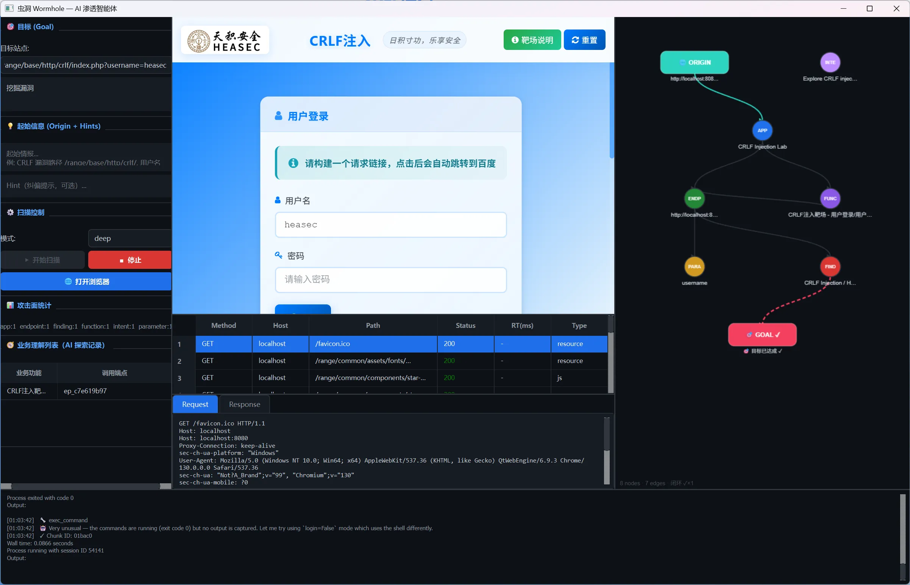

<div align="center">

# 虫洞 Wormhole
### 面向复杂攻击链的图谱认知渗透智能体

[-2b9246?style=flat-square)]()
[]()
[]()
[]()


</div>

---

## 概述

真实业务系统中的漏洞多以多阶段、跨边界的链式形态存在：单个注入点往往只是攻击链入口，达成目标还需要凭据提取、横向移动等多个环节的衔接。规则驱动的扫描工具无法覆盖未知漏洞模式；线性对话式的 LLM Agent 缺乏结构化的知识持久化，长程任务中上下文丢失、重复探索已排除路径。

Wormhole 将渗透测试建模为**知识图谱（DAG）的增量构建过程**：每一步侦察发现、漏洞确认、凭据获取与 flag 捕获均以不可变事实节点沉淀，推理在图谱拓扑上展开，死胡同被显式标注并在后续轮次中剪枝。三条设计原则：

| 设计原则 | 含义 |
|----------|------|
| **知识只增不改** | 事实节点 append-only，推理历史完整可溯，跨轮次可继承 |
| **决策基于图谱状态** | 方向选择、停滞判定、退出控制由图拓扑的标量比较驱动，不依赖 LLM 自我评估 |
| **预算流向信息增益** | 止损轮转调度使时间预算持续流向有产出的方向，而非单题耗尽 |

## Benchmark 结果

TSec Benchmark v1（63 题 / 23000 分 / 360 min / 并发 3 / DeepSeek V4）：

<div align="center">

<table>
  <tr><th>指标</th><th>数值</th></tr>
  <tr><td>总得分</td><td><b>21000 / 23000（91.3%），总榜前三</b></td></tr>
  <tr><td>flag 捕获</td><td><b>68 / 74</b>（含多 flag 题）</td></tr>
  <tr><td>首轮遍历</td><td>~180 min 完成全部 63 题，50 flag / 15550 分</td></tr>
  <tr><td>首个 flag</td><td>启动后第 7 min</td></tr>
  <tr><td>能力域覆盖</td><td>Web 漏洞 / 二进制漏洞 / CVE 利用 / AI 应用安全 / 云攻击 / 对抗规避，全部有产出</td></tr>
  <tr><td>多阶段渗透</td><td>多台靶机全 flag（4/4），完整走通外网 → 内网横向 → OA → 数据库链路</td></tr>
</table>


<sub>flag 累积曲线：Phase 1 全题快遍 180 min 内爬升至 50，Phase 2 wall-clock 重试阶段收敛至 68。</sub>

</div>

## 系统架构

三层分离，接口严格解耦；认知层不感知执行后端实现，同一套推理逻辑可运行于 Docker 编排与单容器子进程两种部署形态。

| 层 | 职责 | 核心模块 |
|----|------|----------|
| 编排层 | 多题并发调度、预算管理、重试队列、平台 API 交互 | `Scheduler` · `BenchmarkClient` |
| 认知层 | 单题内多轮探索决策、图谱演化、完成/停滞判定 | `Dispatcher` · `Blackboard` |
| 执行层 | LLM 自主工具调用，claude CLI 驱动 Kali 环境 | `Worker`（docker / local 双后端） |

```
┌─────────────────────────────────────────────────────────────────┐
│  编排层 Orchestration                                            │
│  Scheduler（多题并发/止损轮转）  BenchmarkClient  ResourceManager │
└────────────────────────────┬────────────────────────────────────┘
                             │
┌────────────────────────────▼────────────────────────────────────┐
│  认知层 Cognition — Blackboard 知识图谱 (SQLite, append-only)     │
│                                                                 │
│         ┌─────┐        ┌─────┐        ┌─────┐                   │
│   origin┤ f001├────────┤ f002├───┐    ├─f004 │◄ dead-end 标注   │
│         └──┬──┘        └──┬──┘   │    └──────┘                   │
│            └───────┐       │   ┌──▼───────────┐                 │
│                  ┌─▼────┐  │   │     goal     │                 │
│                  │ f003 │──┴──►│   (flag ✓)   │                 │
│                  └──────┘      └──────────────┘                 │
│                                                                 │
│     OODA: Bootstrap → Reason → Explore → Checkpoint ↻           │
└────────────────────────────┬────────────────────────────────────┘
                             │
┌────────────────────────────▼────────────────────────────────────┐
│  执行层 Execution — Worker 双后端抽象                             │
│         WORMHOLE_WORKER_BACKEND = docker │ local                │
│   ┌─────────────────────────┐  ┌─────────────────────────┐      │
│   │ Docker Backend（本地）   │  │ Local Backend（托管沙箱） │      │
│   │ Kali 容器 + claude CLI   │  │ subprocess + claude CLI  │      │
│   └─────────────────────────┘  └─────────────────────────┘      │
└─────────────────────────────────────────────────────────────────┘
```

### 图谱数据模型

| 元素 | 定义 |
|------|------|
| **Fact 事实节点** | 不可变知识单元，携带唯一 ID 与自然语言描述；一经创建永不修改 |
| **Intent 探索意图** | 有向边；推理阶段创建（目标槽位为空），探索产出后关闭并指向新事实，构成推理链路 |
| **Dead-end 标注** | 三层优先级分类：强正面信号（`flag{` / `RCE confirmed`）＞ 强否定短语（`ruled out` / `not injectable`）＞ 中性；被排除方向以 `dead_end: true` 导出，供后续轮次规避 |

### OODA 认知循环

| 阶段 | 行为 | 产出 |
|------|------|------|
| **Bootstrap** | 初始化侦察，建立 origin / goal 节点，注入题型方法论与重试经验块 | 初始图谱 |
| **Reason** | 读取图谱拓扑，生成下一轮探索方向 | 探索意图集合 |
| **Explore** | 并发执行工具调用（默认 3 路） | 新事实节点 |
| **Checkpoint** | 比对事实数 / 开放意图数 / 提示数三标量，判定信息增益 | 继续 / 重置假设 / 退出 |

### 关键机制

| 机制 | 解决的问题 |
|------|-----------|
| **自适应止损轮转调度** | 两阶段策略：统一窗口全题快遍（~90 min 收割约 80% flag）后进入 wall-clock 全窗口重试，预算按轮刷新投入未解题目 |
| **跨轮次经验复用** | 重试不冷启动：从旧图谱提取「已确认发现 + 已排除死路」结构化经验块注入新 origin，探索方向逐轮收敛 |
| **失效 flag 感知** | 对抗靶场实例轮换导致的 flag 漂移：被拒值进入失效集永不重提，完成判定对失效集作差，杜绝「已捕获未得分」的空转重试 |
| **双路提交状态机** | 实时路径（事实写入即异步提交）+ 批量路径（题目结束兜底补交）；去重集合仅在提交成功后更新，网络失败时 flag 保持可重试 |
| **三重退出门控** | 预算硬墙 / flag 停滞检测（容忍度随已获 flag 数线性放大）/ 基础设施宕机检测，各针对一类预算浪费模式 |
| **题型自适应知识库** | 索引路由 + 七领域专题决策树（Web / 二进制 / AI 应用 / 区块链 / CVE 利用 / 对抗规避 / 云），按需加载，单层负载受控于上下文窗口 |

## 快速开始

### 环境要求

- Python ≥ 3.12，Docker
- 任一 Anthropic 兼容 API（DeepSeek / Kimi / GLM 等）
- 执行智能体依赖 [claude code](https://docs.anthropic.com/en/docs/claude-code) CLI（Worker 镜像内已预装）

### 安装

```bash
git clone https://github.com/Gach0ng/Wormhole.git
cd Wormhole

pip install .            # 核心依赖：fastapi + uvicorn
pip install ".[gui]"     # 可选：桌面 GUI（PySide6）
```

### 配置

| 环境变量 | 必填 | 说明 |
|----------|:----:|------|
| `ANTHROPIC_BASE_URL` | ✓ | Anthropic 兼容 API 地址，如 `https://api.deepseek.com` |
| `ANTHROPIC_AUTH_TOKEN` | ✓ | API Key |
| `ANTHROPIC_MODEL` | ✓ | 模型名，如 `deepseek-v4-pro` |
| `BENCHMARK_TOKEN` | ✓* | 平台答题 Token（平台托管模式下由沙箱自动注入） |
| `BENCHMARK_BASE_URL` | ✓* | 平台 API 地址（同上） |
| `WORMHOLE_WORKER_BACKEND` |  | `docker`（默认，本地多容器）/ `local`（托管沙箱） |
| `SOLVER_IMAGE` |  | Worker 镜像名，默认 `wormhole-solver:latest` |

### 构建 Worker 镜像（本地模式）

```bash
# Kali + 全套渗透工具（nmap / sqlmap / gdb / pwntools / nuclei / ...）
docker build -f containers/Dockerfile.solver -t wormhole-solver:latest .
```

### 运行

**CLI 批量解题**（本地与平台托管同一路径）：

```bash
python -m wormhole.solver.cli_solve --concurrency 3 --wall-clock 350 -v
# 或使用封装脚本：bash solve.sh <TOKEN> all
```

| 参数 | 默认 | 说明 |
|------|------|------|
| `--concurrency` | 3 | 并发解题数（受平台三容器上限约束） |
| `--wall-clock` | 350 | 总时间窗口（min），启用全窗口重试 |
| `--per-challenge-budget` | 2400 | 单题总预算（s），多 flag 题按 flag 数放大 |
| `--max-rounds` | 20 | 单题最大认知轮数 |
| `--runs-dir` | `solver_runs/` | 运行数据目录 |
| `--skills-dir` | 内置 | 方法论知识库路径，传空串禁用挂载 |

**Web UI 看板 / 桌面 GUI**：

```bash
python -m wormhole.solver.webui     # Web UI · http://localhost:8765
python -m wormhole.ui.launch        # 桌面 GUI（可选：WORMHOLE_GUI_PROXY=1 / WORMHOLE_GUI_CDP=1）
```

<table>
  <tr>
    <td width="50%" align="center" valign="top"></td>
    <td width="50%" align="center" valign="top"></td>
  </tr>
  <tr>
    <td align="center"><sub><b>Web UI</b> · 题目进度 / flag 统计 / 知识图谱可视化</sub></td>
    <td align="center"><sub><b>桌面 GUI</b> · 攻击面图谱 / 代理流量 / 内置浏览器</sub></td>
  </tr>
</table>

### 托管沙箱部署

面向单容器、禁用嵌套 Docker 的评测平台：

```bash
docker build -f containers/Dockerfile.slim -t wormhole-hosted:slim .
docker save wormhole-hosted:slim | gzip > wormhole-hosted.tar.gz
```

入口脚本自动完成 LLM 网关 URL 转换（`.tsecbench.gw` 后缀）、root 沙箱适配（`IS_SANDBOX=1`）、Local 后端切换并启动全量解题。详见 [`containers/HOSTED_README.md`](containers/HOSTED_README.md)。

## 仓库结构

```
Wormhole/
├── wormhole/
│   ├── solver/                  # 编排 + 认知 + 执行核心
│   │   ├── cli_solve.py         #   CLI 入口 / Scheduler / flag 提交状态机
│   │   ├── dispatcher.py        #   OODA 循环 / 完成与停滞判定
│   │   ├── blackboard.py        #   知识图谱（SQLite DAG，append-only）
│   │   ├── worker.py            #   Worker 双后端抽象（docker / local）
│   │   ├── tasks.py / prompts/  #   任务执行与 Prompt 模板
│   │   ├── webui.py + static/   #   Web 看板（FastAPI，:8765）
│   │   └── skills/              #   方法论知识库（索引路由 + 专题决策树）
│   ├── orchestrator/
│   │   └── benchmark_client.py  # 平台 API 客户端（start / submit / close）
│   └── ui/                      # 桌面 GUI（运行看板 + 内置浏览器）
├── containers/                  # Dockerfile.solver / .slim / .hosted + 入口脚本
├── docs/images/                 # 品牌与截图资源
└── solve.sh                     # 本地解题封装脚本
```

## 延伸阅读

- [`wormhole/solver/skills/ctf-solve-strategy/SKILL.md`](wormhole/solver/skills/ctf-solve-strategy/SKILL.md) —— 题型路由索引与七领域方法论决策树
- 各核心模块（`blackboard.py` / `dispatcher.py` / `cli_solve.py` / `worker.py`）头部含完整设计说明

## 免责声明

Wormhole 仅供**授权安全测试**使用：CTF 竞赛、自有靶场、书面授权的渗透测试与安全研究。使用者须自行确保测试行为在授权范围内，并对使用本工具产生的一切后果负责。禁止用于任何未授权用途。

## License

Apache-2.0. See [LICENSE](LICENSE).
